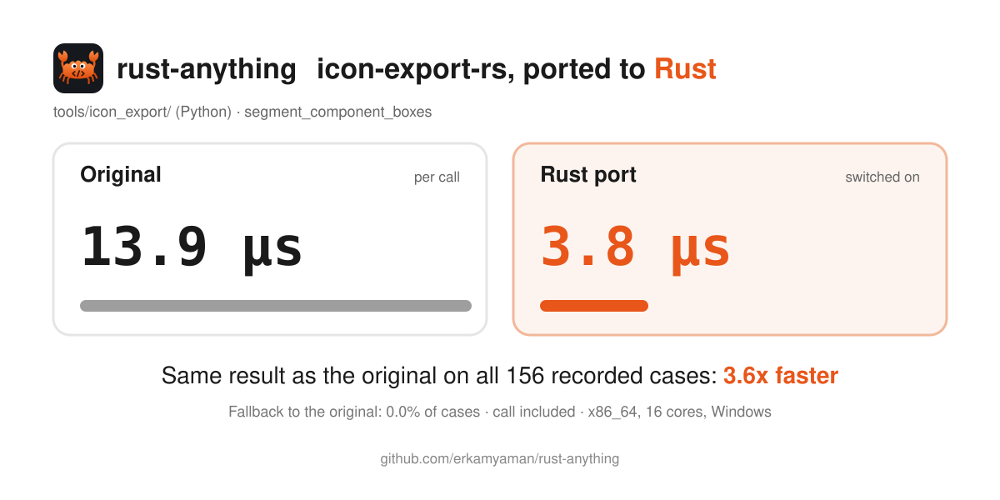

## `icon-export-rs` in Rust

| | |
| --- | --- |
| Unit | `tools/icon_export/` (Python) |
| Recorded cases matched | 156 / 156 |
| Speedup, call included | 3.6x (geometric mean) |
| Fallback to the original | 0.0% (0 of 156 cases) |
| Switched on | on |

| Function | Cases | Original per call | Rust per call | Speedup |
| --- | ---: | ---: | ---: | ---: |
| `segment_component_boxes` | 156 | 13.9 µs | 3.8 µs | 3.6x |

Measured with `rust-anything report` on x86_64, 16 cores, Windows: `diff` replays every recorded case, `bench` times them on both sides as callers call them. Reproduce: `rust-anything diff` and `rust-anything bench` in the crate folder.
