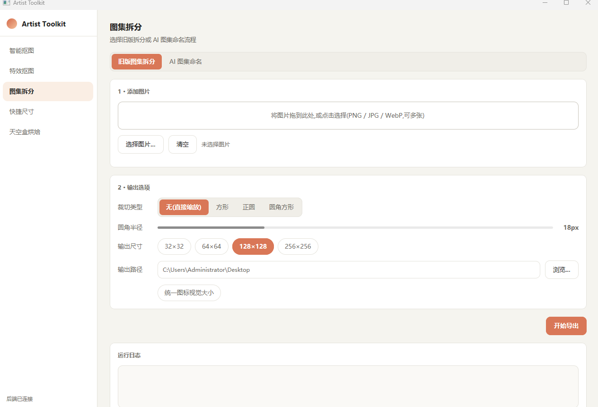
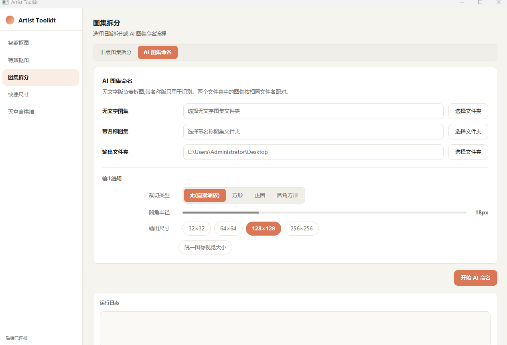
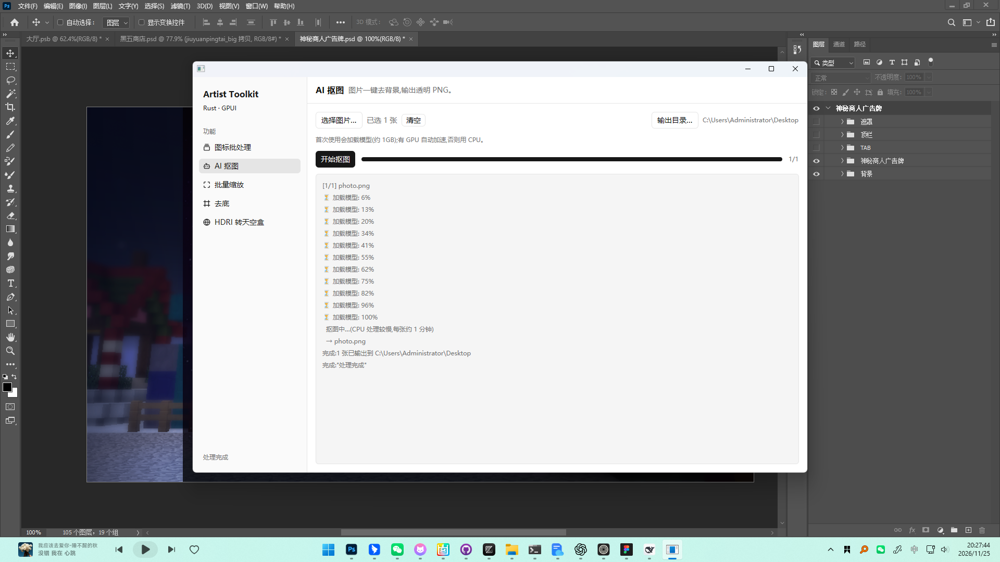
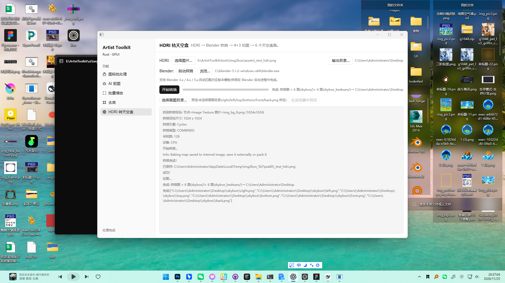
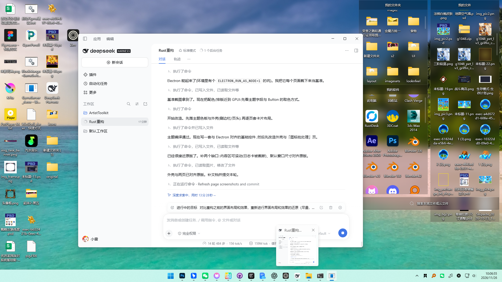

# ArtistToolkit · Rust/GPUI 前端








用 [gpui-kit](https://github.com/longbridge/gpui-kit)(GPUI 组件库)重写的桌面界面,
用来替换 Electron 外壳。

## 界面还原(Electron → GPUI)

配色与排版按 `app/renderer/styles.css` 还原(Claude 风:暖米白 `#f5f4ef` + 白卡片 + 珊瑚橙 `#d97757`,13px 基准、10px 圆角):

- `ui/src/theme.rs`:覆盖 gpui-kit 全局主题(背景/边框/主色/圆角/字体),组件与自绘控件共用一套色板
- `ui/src/widgets.rs`:卡片、卡片标题、按钮(默认/主色)、分段选择、chip、复选 chip、字段行、拖放区、日志面板、运行条
- 侧边栏 208px 白底 + 品牌圆点 + 纯文本页签(选中珊瑚橙浅底,与 `.nav-btn.active` 一致)
- 已还原页:**全部五页**(图集拆分 / 智能抠图 / 快捷尺寸 / 特效抠图 / 天空盒烘焙),页签名与顺序同 Electron(features.js)

原版截图基准在 `docs/reference/electron-*.png`,由 `scripts/capture_reference.py` 通过 DevTools 协议逐页抓取。

已还原:滑杆(`圆角半径` / `Defringe`)、缩略图网格与删除按钮、拖拽高亮、顶部「旧版图集拆分 / AI 图集命名」分段与 AI 命名面板。

仍存在的差异:天空盒页多了一个「自动探测」按钮(原版只有浏览);缩略图删除按钮常显(原版 hover 才显示);AI 命名依赖本机 Codex CLI,没有时后端跳过重命名、保留编号(与原版一致)。

## 现状

五个页签全部迁移完成,功能与 Electron 版等价:

| 页签 | 状态 | 后端命令 |
| --- | --- | --- |
| 图集拆分 | ✅ 拖拽/选图/裁切类型/尺寸/圆角/统一大小/日志 | `icon_process` |
| 智能抠图 | ✅ 拖拽/选图/输出目录/日志 | `matting_process` |
| 快捷尺寸 | ✅ 拖拽文件夹/输入输出目录/预设与自定义尺寸/等比/取消 | `resize_process`、`resize_cancel` |
| 特效抠图 | ✅ 拖拽/选图/背景模式/去边/重建 Alpha/跳过已存在 | `unmult_process` |
| 天空盒烘焙 | ✅ 拖拽 HDRI/Blender 自动探测/烘焙/预览 | `img2box_process`、`img2box_find_blender`、`img2box_preview` |

**拖拽**:每页顶部有提示条,把文件直接拖进窗口即可(与 Electron 版一致)——图片页追加图片并按路径去重,
批量缩放接受文件夹作为输入目录,天空盒取第一张图片作为 HDRI。截图:[去底页拖入 2 张](docs/screenshot-drop.png)。

界面外壳(侧边栏、页签、主题、中文字体、后端连接状态)已完成;Electron 版仍保留
(`start-electron.bat`),方便对照与回退。

## 架构

```
ui/ (Rust + GPUI)
  └── stdio 逐行 JSON  ←→  Python 后端(backend.py 或 dist/ArtistToolkit-backend.exe)
                              └── tools/*/core.py
                                    └── 已移植的 Rust 内核(rust/unmult-rs、rust/icon-export-rs)
```

- 界面不重写业务逻辑:与 Electron 版共用同一套后端协议(`{"id","cmd"}` / `{"id","ok",...}` / `{"id","event":...}`)。
- 后端启动顺序:优先 `dist/ArtistToolkit-backend.exe`(打包版,含 Rust 内核),否则 `python backend.py`;
  若仓库内有 `models/birefnet-general.onnx`,会像 Electron 一样设置 `ATK_MODELS_DIR` 免下载模型。
- 后端输出在后台线程读、经 channel 回到 GPUI 的 async 任务,界面只做状态渲染。
- 任务用 `JobKind` 标记归属页,后端日志/进度只回到发起它的页面;一次性查询(`Query`)走同一条通道。

## 运行与打包

```powershell
cd ui
cargo run                     # 开发运行
cargo build --release         # 发布构建: target\release\artist-toolkit-ui.exe
```

需要 Rust 1.97+ 与 MSVC Build Tools;首次编译 GPUI 约 3–4 分钟(实测 release 7.5 分钟)。

分发包在仓库根目录构建:

```bat
package.bat        # 构建后端 exe + 组装 dist-gpui\ (前端 + 后端 + 模型)
start.bat          # 默认启动入口:优先 dist-gpui\ArtistToolkit.exe,其次 release/debug,都没有则自动构建
start-electron.bat # 旧版 Electron 界面
```

`dist-gpui\` 整个目录可直接拷给别人:后端是自带 Python 与 Rust 内核的单文件 exe;
前端按**自身所在目录**找后端(`ARTIST_TOOLKIT_ROOT` 可覆盖),因此不依赖仓库路径。
实测:从 `C:\` 启动 `dist-gpui\ArtistToolkit.exe`,子进程确认为 `dist-gpui\ArtistToolkit-backend.exe`。

## 开发期自动化(仅 debug 构建)

```powershell
# 预填 + 自动开跑,截图后退出
$env:ATK_UI_TAB='icon'                              # icon / matting / resize / unmult / img2box
$env:ATK_UI_IMAGES='E:\path\a.png;E:\path\b.png'    # 图标批处理/抠图/去底 预填图片
$env:ATK_UI_DROP='E:\path\a.png;E:\path\b.png'      # 模拟一次拖放(与真实拖放走同一个处理函数)
$env:ATK_UI_RESIZE_IN='E:\path\images'              # 批量缩放 预填输入目录
$env:ATK_UI_HDRI='E:\path\pano.png'                 # 天空盒 预填 HDRI
$env:ATK_UI_BLENDER='C:\blender-5.1.2-windows-x64\blender.exe'
$env:ATK_UI_SKYBOX='C:\path\skybox'                 # 天空盒 预填面图目录(用于预览)
$env:ATK_UI_AUTORUN='1'                             # 1=开跑 / detect=只探测 Blender / preview=只开预览
$env:ATK_UI_NO_BROWSER='1'                          # 预览时不要真的打开浏览器
powershell -File scripts\screenshot.ps1 -Out _shot.png
```

`screenshot.ps1` 会启动应用、把窗口放到**副屏**、截该屏(可裁成窗口)再退出,用于验证界面改动:

- 默认选第一块非主屏,避免打断主屏工作;可用 `-Monitor 1` 指定
- `-Crop`:只截窗口客户区(文档截图用的就是它,输出 1264×861,与 Electron 基准同尺寸)
- `-WindowStyle Hidden`:debug 构建自带控制台,脚本会把它隐藏
- `ATK_UI_WINDOW_POS="x,y,w,h"`:让应用直接开在指定位置(脚本用它把窗口开在副屏,不闪主屏)

## 验证过的端到端场景

| 页面 | 输入 | 结果 |
| --- | --- | --- |
| 图标批处理 | 512×512 透明图集 | 4 个图标 + `original/128` 产物 |
| AI 抠图 | 480×360 图片 | RGBA 输出,角落 alpha=0 |
| 批量缩放 | 含子目录的 2 张图 → 1024×1024 | 保持目录结构,2/2 成功 |
| 去底 | 1024×1024 黑底图 | 透明 PNG,21× 内核加速 |
| HDRI 转天空盒 | 1024×512 全景图 + Blender 5.1.2 | 2048×1536 烘焙图 + `skybox/`、`skybox_bedwars/` 各 6 面;预览服务返回 viewer.html 与 6 张面图 |

## 后续

1. 拖拽入队(gpui 文件拖放)、窗口图标定制。
2. 后端启动偏慢(PyInstaller onefile 解包 + rembg 预导入,首次连接约 20–35 秒),可考虑改 onedir 或连接期间给出更明确的提示。
3. 可选:让缩略图删除按钮只在悬停时出现(需要每张图维护 hover 状态)。
